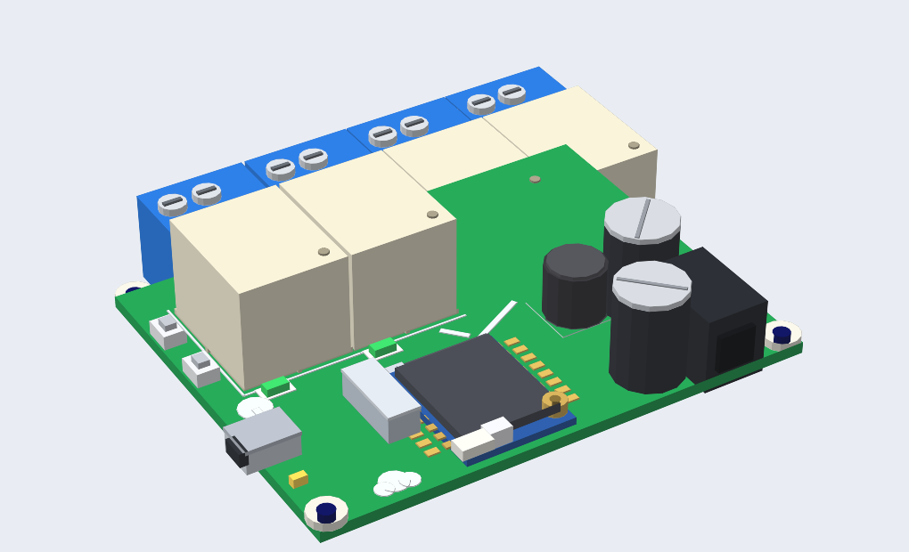
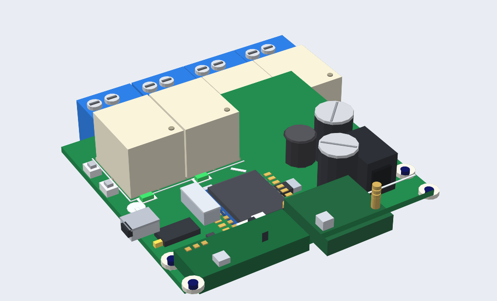

# ESP-07 ×4 Relay Board — بازمهندسی دقیق ECA-22665 + افزونه RF433

بازمهندسی کامل برد تجاری **«برد کنترل ۴ رله WiFi ایرانیک (ESP-07)»** (فروشگاه ECA، کد ۲۲۶۶۵ / iranicboard.ir) — بر پایه عکس‌های رسمی سازنده، نه حدس.
به‌علاوه نسخه توسعه‌یافته **V2** با گیرنده/فرستنده **RF 433MHz**، شماتیک، مدل سه‌بعدی تعاملی، PCB در KiCad و فریمور نمونه.




## 🧭 ساختار ریپو

| مسیر | محتوا |
|---|---|
| `docs/schematic_v1.svg` | شماتیک بازسازی‌شده برد اصلی (۱۲V ← باک ۵V ← ۳٫۳V، CH340G، ESP-07، ۴ کانال رله) |
| `docs/schematic_v2.svg` | همان برد + بخش RF433 (RX→GPIO14 ، TX→GPIO16) |
| `docs/ESP07_REFERENCE.md` | **مرجع کامل ماژول ESP-07** برای کدنویسی: پایه‌ها، قوانین بوت، جریان، ترفندها |
| `docs/reference-photos/` | عکس‌های رسمی سازنده (روی/زیر/برچسب‌دار) که این بازمهندسی بر پایه آن‌هاست |
| `viewer/board_3d.html` | **نمای سه‌بعدی تعاملی تک‌فایل** — بدون نیاز به اینترنت؛ V1/V2، چرخش، زوم، شناسایی قطعه با کلیک، قطعات پشت‌برد هم مدل شده |
| `hardware/kicad/` | پروژه **KiCad 7**: قرارگیری قطعات مطابق برد واقعی + نت‌لیست کامل + روتر اولیه تغذیه/کانال‌ها |
| `hardware/pcb_preview.png` | پیش‌نمای رندرشده PCB |
| `firmware/pin_finder.ino` | اسکچ راستی‌آزمایی نگاشت رله‌ها |
| `firmware/rf433_demo.ino` | فریمور V2: وب‌سرور کنترل رله + rc-switch روی GPIO14/16 |
| `tools/gen_kicad.py` | تولیدکننده PCB (پایتون) — موقعیت‌ها و نت‌ها در قالب کد |
| `tasmota/` | تمپلیت‌های آماده Tasmota برای V1 و V2 (با RF) |
| `docs/TASMOTA.md` | تحلیل Tasmota: چه چیزهایی‌اش برای این بردها به درد می‌خورد + دستورهای آماده |

## 🔑 نگاشت تأییدشده از سیلک برد

| کانال | سیلک | GPIO |
|---|---|---|
| RELAY1 | D04 | **4** |
| RELAY2 | D05 | **5** |
| RELAY3 | D12 | **12** |
| RELAY4 | D13 | **13** |

RF433 (V2): گیرنده DATA → **GPIO14** (تنها پایه آزاد با وقفه خارجی) • فرستنده DATA ← **GPIO16** (با شیفتر سطح 2N7002)

## 🔩 سخت‌افزار تأییدشده از روی عکس‌ها

- **رله‌ها:** SANYOU **SRD-S-112D2-F-C1** (T73‌، بوبین ۱۲V، ‏۷A/250VAC – ۱۰A/125VAC)
- **درایور باک:** پکیج **D2PAK-5 پشت برد** (کلاس LM2576-5) + سلف درام‌کور **۱۰۰µH (مارک ۱۰۱)** + ۲× **۱۰۰۰µF/16V** + تانتالوم ۴۷۰µF/16V
- **USB↔UART:** CH340G + کریستال ۱۲MHz (HC-49) — پشت برد
- **ESP-07:** شیلد ESP8266MOD، آنتن سرامیکی + U.FL، بدون سوکت (کاستلیشن مستقیم)
- **کانال‌ها:** SOT-23 NPN + مقاومت بیس ۱k + دیود فلای‌بک شیشه‌ای (پشت برد)
- **ابعاد برد:** ≈ ۷۲×۵۶mm (از روی مقیاس رله T73 اندازه‌گیری شده؛ در KiCad خط ۷۲×۵۶ با افزونه V2 به ۷۲×۶۶)

## 🚀 شروع سریع فریمور

```cpp
const uint8_t RELAY[4] = {4, 5, 12, 13};
void setup(){ for(auto p:RELAY){ pinMode(p,OUTPUT); digitalWrite(p,LOW);} }
```

جزئیات کامل (بوت‌استرپ‌ها، تغذیه، rc-switch، Deep-Sleep، …) در `docs/ESP07_REFERENCE.md`.

## PCB (KiCad 7)

- چیدمان فوتپرینت‌ها **مطابق عکس برد واقعی** است؛ نت‌لیست کامل روی پدها نشسته و نت‌های اصلی تغذیه و ۴ کانال رله + زنجیره RF روتر شده‌اند؛ GND زون دوطرفه دارد.
- فوتپرینت‌های سفارشی (با پسوند `hack_`/نام‌های محلی) در فایل جاسازی شده‌اند؛ برای تولید Gerber آن‌ها را با فوتپرینت‌های کتابخانه‌ای KiCad جایگزین/به‌روز کنید (**Design → Update Footprints**) و باقی airwireها را کامل روتر کنید.
- پدپترن رله، فوتپرینت **رسمی KiCad** برای خانواده SANYOU SRD (`Relay_SPDT_SANYOU_SRD_Series_Form_C`) است — امن است.

## 🔗 ریپوی خواهر
[Esp32 IX4 Relay Board](https://github.com/ghahremany/esp32-4relay-board) — نسخه ESP32 همین برد از ایرانیک: شماتیک، سه‌بعدی، مرجع WROOM-32 و تمپلیت Tasmota.

## ⚠️ هشدار ایمنی

ترمینال‌ها برای برق شهر طراحی شدند: مدار ایزوله نیست؛ فاصله خزشی، فیوز و جعبه عایق را رعایت کنید. مسئولیت استفاده با کاربر است.

## مجوز

MIT — متن کامل در `LICENSE`. عکس‌های مرجع متعلق به سازنده (iranicboard.ir / ECA) است و فقط برای مستندات بازمهندسی آورده شده‌اند.
