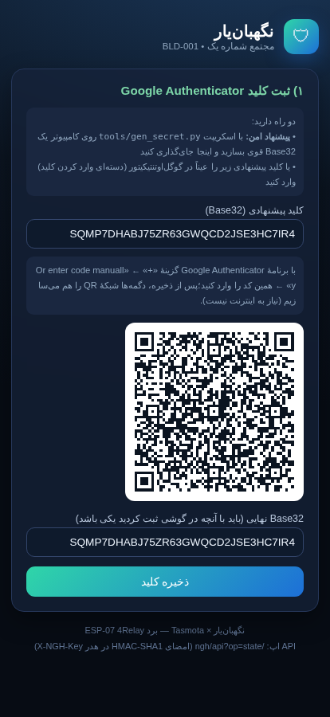
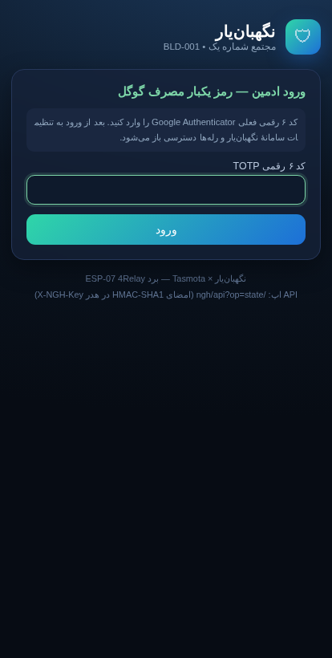
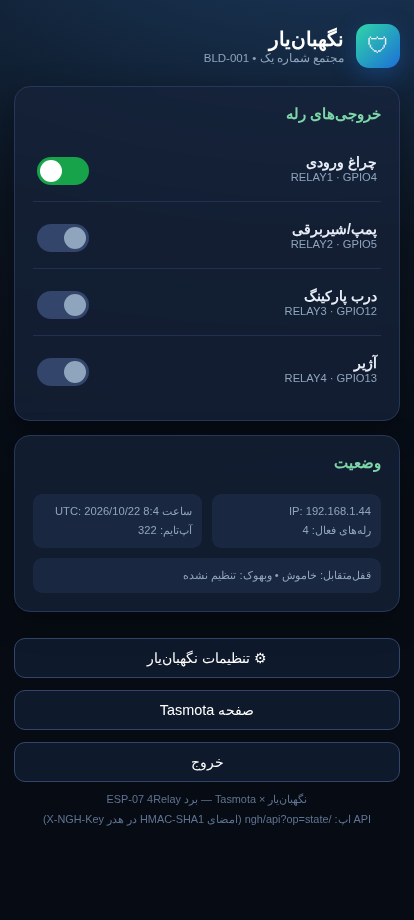
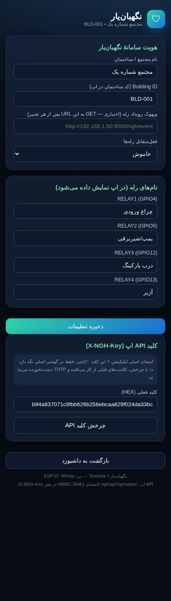

# نگهبان‌یار برای Tasmota — برد ESP-07 چهار رله

نسخهٔ سفارشی فریمور [Tasmota](https://github.com/arendst/Tasmota) برای برد ESP-07 4Relay (نگاشت تأییدشده: R1..4 ← GPIO4/5/12/13) با:

- 🌙 **رابط کاربری مدرن فارسی — دارک RTL** (داشبورد، لاگین، تنظیمات) + ابزار بازنقش‌سازی صفحات اصلی Tasmota (`tools/apply_theme.sh`)
- 🔐 **ورود ادمین با رمز یکبارمصرف Google Authenticator** — TOTP استاندارد RFC 6238 (SHA-1، پنجرهٔ ۳۰ ثانیه، ۶ رقم). کلید روی خود برد در فایل‌سیستم LittleFS ذخیره می‌شود؛ ۵ خطای متوالی = قفل ۱۸۰ ثانیه‌ای؛ نشست کوکی امضاشده ۱۰ دقیقه‌ای.
- ⚙ **صفحهٔ تنظیمات سامانهٔ نگهبان‌یار**: نام مجتمع/Building ID، نام‌های رله، وبهوک رویداد رله، Interlock، و چرخش کلید API
- 📲 **API بومی برای اپ نگهبان‌یار**: هر فرمان رله با امضای HMAC-SHA1 (کلید متقارن ۲۰بایتی روی دستگاه) و timestamp ضدبازپخش — قرارداد کامل در `docs/API.md`

## پیش‌نمایش پنل (رندر دقیق کد درایور)

| راه‌اندازی (QR آفلاین) | ورود TOTP گوگل | داشبورد | تنظیمات |
|---|---|---|---|
|  |  |  |  |

راهنمای کامل هر صفحه + HTML پیش‌نمایش زنده: **[docs/PANEL.md](docs/PANEL.md)**

## ساختار پوشه

```
tasmota-negahbanyar/
├── user_config_override.h       ← پیکربندی برد + فعال‌سازی درایور + سبک‌سازی برای فلش ۱MB
├── addons/
│   ├── xdrv_150_neghbanyar.ino  ← درایور اصلی (صفحات + TOTP/HMAC + API)
│   └── qrjs_ngh.h               ← کتابخانه QR آفلاین داخل فلش (فایل تولیدشدهٔ خودکار)
├── assets/qrcode.min.js         ← منبع کتابخانه QR (davidshimjs/qrcodejs, MIT)
├── docs/API.md                  ← قرارداد کامل API برای توسعهٔ اپ (شبه‌کد Kotlin + نمونه curl)
├── docs/PANEL.md                ← راهنمای تصویری پنل (اسکرین‌شات + توضیح هر صفحه)
├── docs/screenshots/            ← اسکرین‌شات‌ها + پیش‌نمایش‌های HTML زندهٔ صفحات
├── tools/apply_theme.sh         ← بازنقش‌سازی ظاهر صفحات مركزی Tasmota به تم نگهبان‌یار
├── tools/gen_secret.py          ← تولید کلید TOTP قوی + otpauth URI (اجرا روی کامپیوتر)
└── tests/test_hmac_totp.py      ← راستی‌آزمایی بردارهای RFC 6238 با همان الگوریتم کد C دستگاه
```

## ۱) ساخت فریمور با Gitpod (ساده‌ترین مسیر — بدون نصب چیزی)

1. در مرورگر باز کنید: **<https://gitpod.io/#https://github.com/arendst/Tasmota>** (لاگین گیت‌هاب کافی‌ست)
2. در ترمینال Gitpod:
   ```bash
   cd Tasmota
   REPO=https://raw.githubusercontent.com/ghahremany/esp07-4relay-board/main/tasmota-negahbanyar
   curl -fsSL $REPO/user_config_override.h -o tasmota/user_config_override.h
   curl -fsSL $REPO/addons/xdrv_150_neghbanyar.ino -o tasmota/tasmota_xdrv_driver/xdrv_150_neghbanyar.ino
   curl -fsSL $REPO/addons/qrjs_ngh.h -o tasmota/tasmota_xdrv_driver/qrjs_ngh.h
   platformio run -e tasmota
   ```
3. خروجی: `.pio/build/tasmota/firmware.bin` (حدود ۷۰۰KB — روی فلش ۱MB جا می‌شود چون ماژول‌های اضافه در override خاموش شده‌اند)
4. روی فایل در Gitpod راست‌کلیک ← Download.

### بیلد محلی (اگر PlatformIO دارید)
کلون Tasmota، کپی همین سه فایل به همان مسیرها، سپس `pio run -e tasmota`.

## ۲) فلش روی ESP-07 (فلش ۱MB)

### فلش مستقیم از سریال (توصیه‌ام برای اولین بار)
```bash
# کلید FLASH را نگه دارید و RESET را یک‌بار بزنید تا به حالت دانلود بروید
esptool.py --port COM6 write_flash 0x0000 firmware.bin
```

### به‌روزرسانی OTA از روی Tasmota موجود
به‌خاطر فلش ۱MB دومرحله‌ای باید بزنید:
1. ابتدا `tasmota-minimal.bin` رسمی را از صفحهٔ OTA روی برد آپلود کنید.
2. بعد، `firmware.bin` کامل خودتان را OTA کنید.
(جزئیات در `docs/TASMOTA.md` ریشهٔ ریپو.)

## ۳) راه‌اندازی اولیه (Boot اول)

```
روشن شدن برد
  ↓
AP موقت «tasmota-XXXX/neghbanyar-XXXX» → اتصال با گوشی → تنظیم WiFi روی http://192.168.4.1
  ↓ پس از اتصال WiFi (ساعت به‌وسیلهٔ NTP سینک شود — TOTP به آن نیاز دارد)
http://<IP-برد>/ngh  →  ریدایرکت خودکار به /ngh/setup
  ↓
کلید Base32 را در /ngh/setup وارد کنید:
  • پیشنهاد امن: با `python3 tools/gen_secret.py BLD-001` کلید را روی کامپیوتر بسازید و در هر دو سمت
    (صفحهٔ وب و گوگل‌اوتنتیکیتور) وارد کنید — صفحه خودش QR هم می‌سازد (آفلاین، روی دستگاه)
  ↓ ذخیره → کلید API اپ هم به‌صورت خودکار مشتق و قفل می‌شود
/ngh/login ← کد ۶ رقمی کنونی Google Authenticator (حداکثر ۵ خطا ≠ قفل ۱۸۰ ثانیه)
  ↓
داشبورد نگهبان‌یار: ۴ خروجی با نام‌های فارسی + لینک به /ngh/config
```

### اتصال اپ نگهبان‌یار
در اپ، برای این واحد: IP برد + Building ID (bid) + کلید API (۴۰ کاراکتر HEX که در /ngh/config دیده می‌شود) را ثبت کنید. روش امضا در `docs/API.md` آمده است؛ اپ شما از قبل HMAC را برای پلاک‌ها پیاده کرده — اینجا فقط HmacSHA1 می‌خواهد.

## ۴) به‌روزرسانی ظاهر خود Tasmota (اختیاری)
صفحات `::/ngh` از قبل مدرن است؛ برای یکدست‌کردن صفحات اصلی Tasmota (که رنگ‌هایش در `xdrv_01_9_webserver.ino` ثابت‌اند):
```bash
cd Tasmota
bash tasmota-negahbanyar/tools/apply_theme.sh
```
اسکریپت فقط با `sed` رنگ‌های Hex موجود را جایگزین می‌کند، ابتدا بکاپ می‌گیرد و اگر نسخهٔ Tasmota شما متفاوت بود فقط هشدار می‌دهد.

## ۵) میزهای توسعهٔ سریع

| چه چیزی را می‌خواهید تغییر دهید | کجا |
|---|---|
| متن‌ها/ترجمهٔ فارسی هر صفحه | مستقیم در رشته‌های PROGMEM همان handler مربوطه در درایور |
| الگوریتم امنیتی (TTL نشست، تعداد خطا، قفل) | ثابت‌های بالای درایور: `NGH_SES_TTL`, `NGH_MAX_FAIL`, `NGH_LOCK_SEC` |
| نگاشت GPIOهای رله | آرایهٔ `NGH_RELAY_GPIO` + `USER_TEMPLATE` در override |
| منطق/پارامتر API | توابع `ngh_handle_api` و `ngh_api_hmac_ok` |
| ظاهر | بلوک شرکت `NGH_CSS` (یک CSS یک‌خطه) |
| افزودن صفحهٔ جدید | تابع `ngh_handle_xxx()` + یک `Webserver->on(...)` در `ngh_web_init()` |
| مقادیر پیش‌فرض هویت ساختمان/نام‌ها | `ngh_defaults()` |

### راستی‌آزمایی بدون دستگاه (بردارهای RFC)
`python3 tests/test_hmac_totp.py` باید همهٔ سطرها را [OK] بگوید — یعنی الگوریتم C ما دقیقاً همان چیزی است که گوگل‌اوتنتیکیتور حساب می‌کند. برای دیباگ دستگاه واقعی، موقتاً `#define NGH_DEBUG_SERIAL` را فعال کنید (فقط روی میز کار — TOTP را در سریال چاپ می‌کند و سپس خاموش کنید).

## ۶) نکات امنیتی صریح
- ساعت دستگاه باید NTP باشد: هم TOTP و هم پنجرهٔ ±۱۲۰ ثانیه‌ای API به epoch واقعی بستگی دارند؛ بدون سینک، حتی با کد درست، کار نمی‌کنند (رفع اشکال: صبر کنید ساعت سینک شود).
- مقایسه‌ها در زمان ثابت (constant-time) هستند.
- توکن نشست: امضا با همان کلید TOTP، HttpOnly، SameSite=Strict.
- فایل `/ngh.cfg` روی LittleFS — پاک کردن/فلش مجدد کامل فلش، تنظیمات + کلید را می‌برد (به حالت setup برمی‌گردد).
- می‌توانید WebPassword تاسموتا (در Configuration → Other) را هم علاوه بر نگهبان‌یار بگذارید — دو لایه مستقل کمکی‌اندِ‌ به‌ vest.

## ۷) تابعیت از درخت Tasmota (development — اکتبر ۲۰۲۶)
- فایل‌سیستم: `USE_UFILESYS` + توابع `TfsLoadFile/TfsSaveFile`
- ثبت وب: `FUNC_WEB_ADD_HANDLER` + دکمهٔ «🛡 نگهبان‌یار» در صفحات اصلی و منوی پیکربندی
- اگر به نسخه جدید بروید و چیزی کامپایل نشد، پای درایور (بلوك SELF-ADAPTIVE NOTES) را ببینید — نکات تطبیق آمده است.

## ۸) دستور فوری از ترمینل (بدون اپ)
```bash
# نمونهٔ کامل ساخت امضا در bash+python (API.md)
KEY="xxxxxxxxxxxxxxxxxxxxxxxxxxxxxxxxxxxxxxxx"  # api_key hex
TS=$(date +%s); B="op=state&i=0&act=x&ts=$TS"
SIG=$(python3 -c "import hmac,hashlib;print(hmac.new(bytes.fromhex('$KEY'),b'$B',hashlib.sha1).hexdigest())")
curl -s "http://<IP-برد>/ngh/api?$B" -H "X-NGH-Key: $SIG"
```
